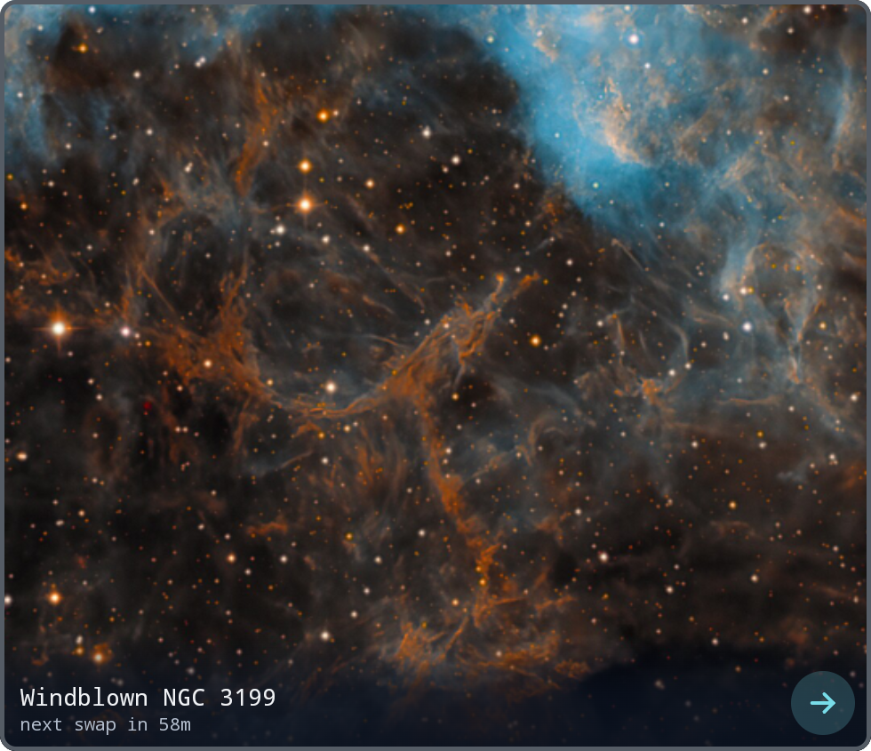
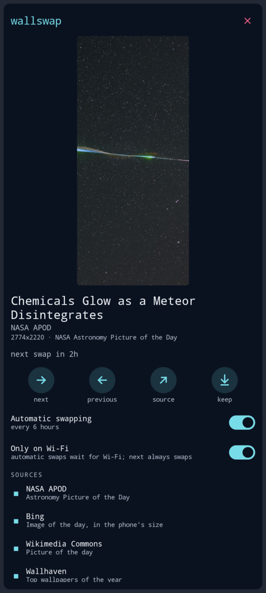

# Wallswap for omalauncher

An [omalauncher](https://github.com/SimonSchubert/omarchy-widgets) home-screen widget that keeps your
wallpaper fresh. Once a day it picks an image from one of a few good sources, crops it to the phone's
screen and sets it as the launcher's background.

It's the phone sibling of [omarchy-wallswap](https://github.com/petrzpav/omarchy-wallswap), the
Omarchy shell plugin that does the same for the desktop: same sources, same network policy, same
cache and history, with the bash script ported to the launcher.

| Source | What you get |
|---|---|
| `apod` | NASA Astronomy Picture of the Day, random from the 30-year archive |
| `bing` | Bing image of the day (last ~2 weeks), in the phone's portrait size |
| `wikimedia` | Wikimedia Commons picture of the day, random from the last 3 years |
| `wallhaven` | Top SFW portrait wallpapers of the year on wallhaven.cc, optionally filtered by a search |
| `local` | A folder of your own images, `~/Pictures/Wallpapers` |

The first four are on by default. Images too small to cover the screen are skipped, repeats are
avoided, and when you are offline it rotates through the ~40 images it has already cached.

<p>
  
  
</p>

## Install

From the **widget store**: long-press empty space on the home screen, open the store and add
**wallswap**. Or by hand: copy [`widget.owl`](widget.owl) to `~/.config/omalauncher/widgets/`
(e.g. as `45-wallswap.owl`). The tile offers to install what it needs (`curl`, `jq`, `file`,
`imagemagick`) on first start.

The **tile** is clear, a window onto the wallpaper itself, with its title and when the next swap is due; **→** swaps now.
**Tap** the tile for its screen:

- the image, its title, credit and resolution (tap it for the source page)
- **next** / **previous** / **source** page / **keep**
- **Automatic swapping**: pause or resume
- **Only on Wi-Fi** (on by default): automatic swaps wait for Wi-Fi, checked again every 10 minutes; **next** always swaps
- **Sources**: switch each on or off (at least one stays on), and how often to swap: 15 min … once a
  day … only when you ask
- **Wallhaven search**, e.g. `space`, `mountains`, `city night`

**Keep** copies the image into the theme's backgrounds under its own name, so it stays in the Style
menu after wallswap moves on.

## How it works

The launcher's wallpaper is `background` in `~/.config/omalauncher/style/style.toml`, a file in
`~/.config/omarchy/backgrounds/<theme>/`. Wallswap crops each image to the screen into that folder as
`wallswap-<source>-<id>.jpg`, points `background` at it and removes the one it showed before. Picking
another background in the Style menu works as usual; wallswap takes over again at the next swap.

The schedule is the widget's: an `at` trigger, which runs while its page is off screen too, calls the
script, and the script decides whether a swap is due. Swaps take a lock, so a tap never overlaps the
timer.

Files: images are cached in `~/.cache/wallswap/`, state is kept in `~/.local/state/wallswap/`.

## Network use

HTTPS only, no redirects, a 2 MB cap on API responses and 80 MB on images, and time limits on every
request. Each source may only return images from its own image host (e.g.
`assets.science.nasa.gov/content/dam/science/cds/apod/`, `w.wallhaven.cc/full/`); anything else is
ignored. Only the `local` source can use a local file, and only one inside its folder. Downloads must
be real JPEG, PNG or WebP data and are decoded with that decoder only.

Wallswap only contacts the sources you switch on: `science.nasa.gov` / `assets.science.nasa.gov`,
`bing.com`, `api.wikimedia.org` / `upload.wikimedia.org` and `wallhaven.cc`. No telemetry. Images keep
their original licenses; the screen shows the credit and links to the source page.

## Development

The store takes one self-contained file, so the script lives in [`wallswap.sh`](wallswap.sh) and
[`build.sh`](build.sh) splices it into [`src/widget.owl`](src/widget.owl), giving `widget.owl`, which
runs it with `bash -c`. Edit those two, run `./build.sh`, and commit `widget.owl` with them.

The script works on its own too:

```bash
./wallswap.sh next '{"sources": ["bing"], "screen": [1080, 2400]}'
./wallswap.sh prev | info | keep | pause | resume | toggle
./wallswap.sh help
```

## Remove

Remove the widget from home, then optionally:

```bash
rm -rf ~/.cache/wallswap ~/.local/state/wallswap
```

The wallpaper stays on the last image until you pick another in the Style menu.

## License

MIT
